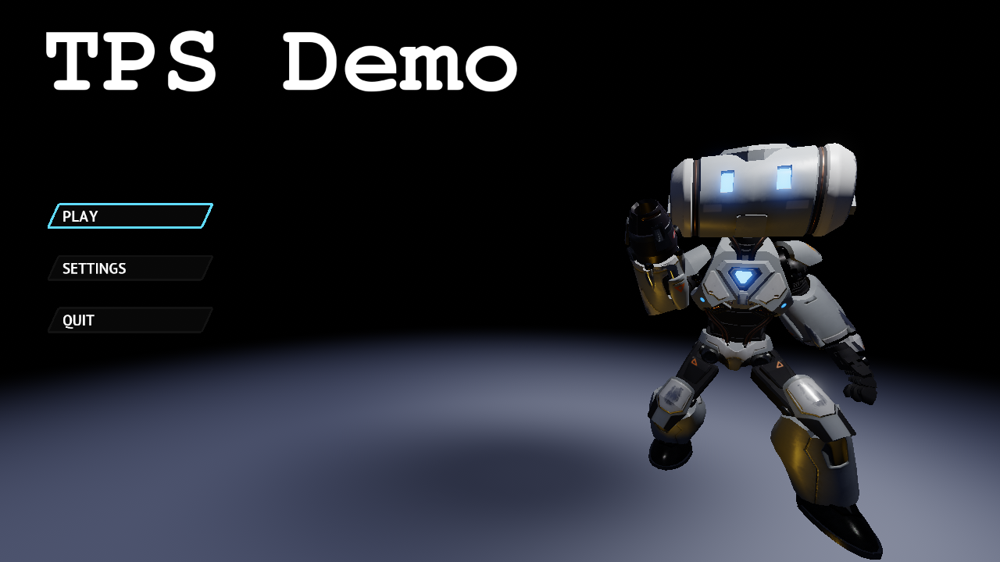
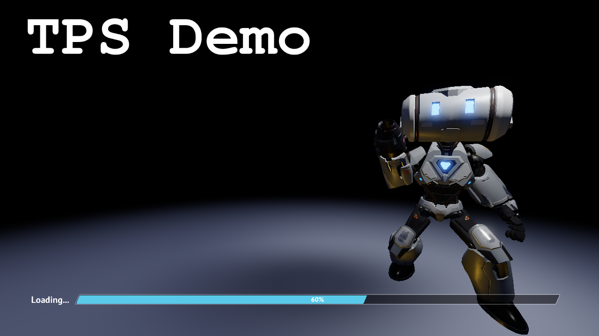
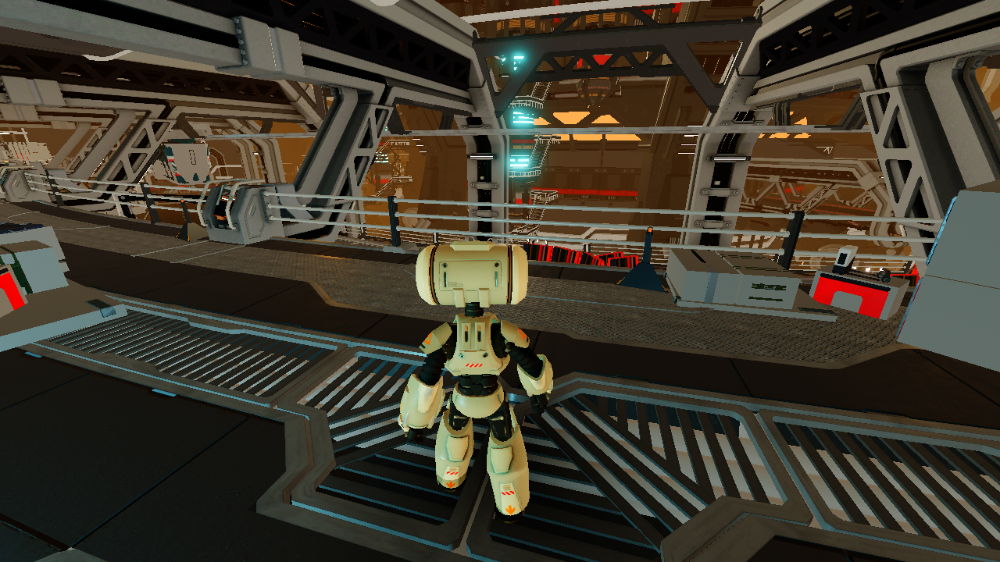
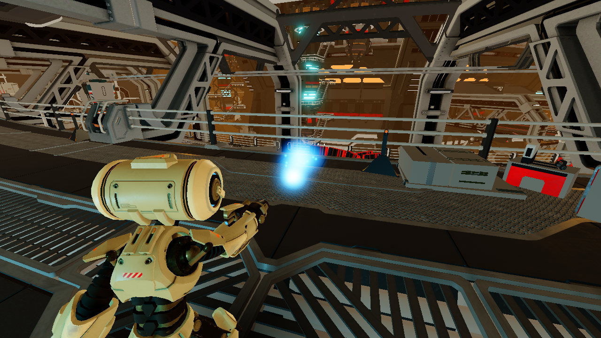
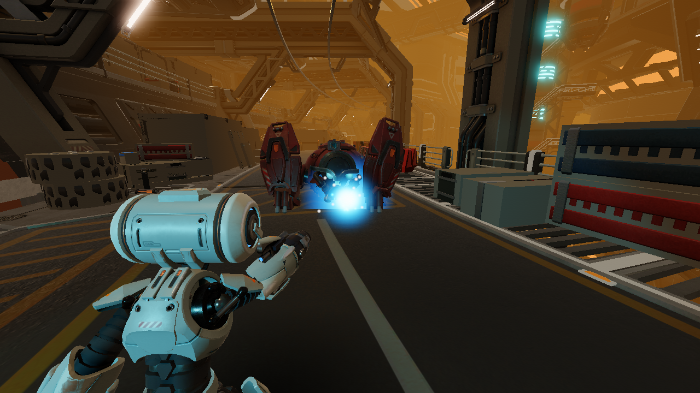
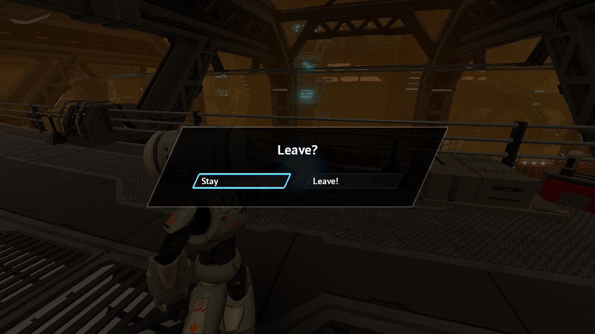

# Third Person Shooter (MonoGame port)

A like-for-like MonoGame (DesktopGL, .NET 10) port of the Godot 4 Third Person Shooter demo (`tps-demo-master/`, Godot 4.7).
The goal is the same look and feel, not byte-identical output. The port is a vertical slice: menu, loading screen, the hangar
level, a controllable player, shooting and one red robot. Desktop only for now.

The port was done with Claude Code. The workflow is captured as a reusable skill, `.claude/skills/godot-to-monogame-port/`
(see "Porting skill" below).

## Screenshots

Captured from this port with `--shot` (in `Documentation/reference/`). The Godot originals are `godot-01..04`.

| | |
|---|---|
|  | Main menu: posed robot, spot lights, emissive eyes and chest (`mono-19` is the idle-pose version, `mono-20` the tuned emissive one) |
|  | Loading screen with the progress bar (`--screen loading:0.6`) |
|  | Start of the level, third person (lighting pass 4) |
|  | Aim camera over the right shoulder, glow shots |
|  | Player aiming at the red robot, bullet hit on the robot |
|  | Pause box "Leave?" over the frozen play frame |

## Status

In the slice:
- Main menu: PLAY > SINGLEPLAYER, MULTIPLAYER (greyed, "coming soon"), SETTINGS, QUIT; posed robot backdrop with the idle animation.
- Settings: display mode, resolution, VSync, bloom, mouse sensitivity, master/music/SFX volume; Apply/Cancel; saved as JSON in the user's ApplicationData folder.
- Loading screen: the menu boots first, the level loads behind a progress bar (one model per frame, 0.5 s hold at 100%).
- Player: 60 Hz fixed step, capsule motor, third-person spring-arm camera, jump, root-motion locomotion (walk, strafe), aim (toggle or hold) with an additive aim pose, shooting with camera shake.
- Four red robots, one per level marker: detection, approach, aim, 4 s shoot timeline with a laser, health 5, hit and explosion effects with the three flying debris parts, respawn 15 s after the explosion (as in level.gd).
- HUD: crosshair while aiming (Godot size and fade) and the black fall fade.
- Level: the two flying forklifts orbit on the original 30 s `mawaru` animation (the random cargo variant is picked with a fixed seed).
- Audio: music with fades, sound effects, 3D attenuation, footsteps, volume sliders (-10 dB master bus as in Godot).
- Pause "Leave?" (Stay / Leave!) and quit "Quit?" (No / Quit!) message boxes; the simulation is fully frozen while a box is open.
- Rendering: HDR target with tonemap and bloom, PBR level materials, fake key light and fog (lighting passes 1-4, see below).

Not in the slice: multiplayer/LAN, per-light shadow maps (one key-light shadow map follows the player, plus a spot shadow for the menu robot; Settings > SHADOWS, off = blob shadow), baked GI (approximated), debris-part contact with the player or other parts, the forklift exhaust particles and spot light,
random player spawn (Godot shuffles 4 markers), robot-vs-robot collision, key rebinding, other platforms (Windows, Linux, mobile are untested; only macOS arm64 was used).
The demo's door scene (`door/door.tscn`) is never instanced by the Godot level, so there are no doors to port.

## Controls

| Action | Keyboard / mouse | Gamepad |
|---|---|---|
| Move | W A S D or arrow keys | Left stick or d-pad |
| Look | Mouse (captured while playing) | Right stick |
| Jump | Space | A |
| Aim | Right mouse button (hold, or tap to toggle) | Left trigger |
| Shoot | Left mouse button | Right trigger |
| Pause ("Leave?") | Esc | Start |
| Menu navigation | Arrow keys / mouse, Enter | D-pad, A; Esc / B = back |

On the main menu Esc opens the Quit box. Aiming halves the look speed (stick) or scales it by 0.75 (mouse), as in the Godot input script.

## Build and run

```
dotnet build Desktop/ThirdPersonShooter.csproj -c Release
dotnet run --project Desktop/ThirdPersonShooter.csproj -c Release
```

Always build **Release**: `Core/Content/ThirdPersonShooter.mgcb` references `PipelineExtension/bin/Release/net8.0/PipelineExtension.dll`,
and `Core.csproj` builds the extension first. A Debug build looks for a DLL that was never built. The first content build takes
minutes (about 90 textures, DXT-compressed, plus the level and character models, about 230 MB of content); later builds only rebuild what changed.
After editing only a `.fxh` shader include, `touch` the `.fx` files that include it.

macOS: if the display was asleep, window creation can hang in SwapWindow (also for `--shot` runs). Run `caffeinate -u -t 2` first.
`Tools/ImageStats/run_shot.sh` does this for you.

VS Code (`.vscode/launch.json`): "Launch Desktop", "Launch Desktop (free-fly camera)", "Run physics self-test"; the build task builds Release.

## Developer flags

Flags skip the menu unless noted, load everything up front, and `--shot` runs use default settings so images do not depend on the machine.

| Flag | Meaning | Example |
|---|---|---|
| `--shot <png>` | Render one frame to a PNG and exit (always t=0 of the animation) | `--shot out.png` |
| `--cam x,y,z,yawDeg,pitchDeg` | Free camera at a pose (implies `--fly`); Godot start framing is `64.8,0.7,78.8,55,-12` | `--noplayer --cam 64.8,0.7,78.8,55,-12 --shot a.png` |
| `--fly` | Free-fly camera instead of the player | `--fly` |
| `--noplayer` | Hide the player | `--noplayer --fly` |
| `--pose clip[,t]` | Show the player in an animation clip at time t | `--pose running_nogun,0.3 --shot p.png` |
| `--sim "<script>"` | Run the fixed-step simulation with synthetic input, then continue or `--shot` the end state | `--sim "w:2;look:30,-5;aim;fire:3" --shot s.png` |
| `--screen <name>` | Open a screen: `menu`, `play-list`, `settings`, `quit`, `pause`, `loading[:progress]` | `--screen loading:0.6 --shot l.png` |
| `--ui "<keys>"` | Feed keys to the current screen once (e.g. `down,down,enter,esc`) | `--screen menu --ui "esc" --shot q.png` |
| `--eager` | Load everything before the first menu frame (no lazy boot) | `--eager` |
| `--audio-log` | Print every played sound with gain and pan (or env `TPS_AUDIO_LOG`); with `--sim` it is audible evidence without listening | `--sim "w:1;aim;fire:1" --audio-log` |
| `--test-physics` | Headless physics/player/robot/bullet checks, exit code = failures | `--test-physics` |
| `--test-ui` | Headless UI kit, settings, focus and loading-plan checks | `--test-ui` |
| `--test-audio` | Headless audio maths and event-table checks | `--test-audio` |

`--sim` items are separated by `;`: `w|a|s|d|w+d:<sec>` hold keys, `look:<yawDeg>,<pitchDeg>`, `tp:x,y,z,yawDeg`, `space[:sec]` jump,
`wait:<sec>`, `aim` / `noaim`, `fire[:n]` hold fire until n bullets spawned, `robot[:k | :ahead,D | :x,y,z,yaw]` place the red robot.
Run from the `ThirdPersonShooter/` folder, e.g. `dotnet Desktop/bin/Release/net10.0/ThirdPersonShooter.dll <flags>`. A few `TPS_*` environment
variables (e.g. `TPS_EXP`, `TPS_KEY`, `TPS_FOG`, `TPS_MEMIS`) override lighting values for tuning; see `Documentation/planning/LIGHTING-NOTES.md`.

## Project layout

```
Core/             Game library and content (Content/ThirdPersonShooter.mgcb is generated for the textures)
  Animation/        generic AnimationPlayer (root motion), PlayerAnimator, RobotAnimator, SkinnedModel
  Audio/            AudioManager, Godot attenuation maths, event table, footstep phases
  Combat/           bullet pool (swept spheres)
  Enemies/          RedRobot (state machine copied from red_robot.gd)
  Game/             LevelScene, load plan (steps + progress), ground probe
  Input/            keyboard/mouse/gamepad map, mouse capture
  Physics/          CollisionWorld, CharacterMotor (from ../Shooter), level colliders
  Player/           constants (cited to Godot file:line), controller, camera, aim, shake
  Rendering/        level/player renderers, HDR post (tonemap, bloom), scene lighting, menu backdrop, glow effects
  Screens/          main menu, settings, loading, message box
  Settings/         GameSettings JSON, display handling
  UI/               hand-written UI kit (theme from the Godot button styles, buttons, sliders, focus)
  Verification/     headless Simulation and the three self-tests
Desktop/          DesktopGL launcher (Program.cs: self-test dispatch)
PipelineExtension/ GLB importer, static and skinned model processors, texture processor (net8.0)
Tools/            GodotExtract (tscn/tres/import -> JSON, level bake), ContentGen (texture section of the .mgcb), GlbCheck (GLB reader checks), ImageStats (screenshot metrics)
Documentation/    planning/ (plans, notes), reference/ (Godot and port screenshots)
tps-demo-master/  the original Godot project (MIT, github.com/godotengine/tps-demo), NOT committed: clone/copy it here to run the extractor (never modified)
```

## How it is verified

Evidence, strongest first: compared against a Godot capture, headless self-test with real values, looks right in a screenshot.
Interactive play has not been exercised by a person yet (see limitations).

- Self-tests (run from `ThirdPersonShooter/` after a Release build; exit code = number of failures). As of this commit: `--test-physics` 24 checks
  pass (landing, walls, steps, jump apex, camera ray, root-motion speed, fire cooldown, bullets, shake, robot walk/turn/hits), `--test-ui` 8/8
  (settings round-trip, focus, message box, loading plan), `--test-audio` 7/7 (bus gain, attenuation, event table, footstep phases, reverb zones, mono 3D sounds, reverb render).
  `Tools/GodotExtract` has a 23-check selftest and `Tools/GlbCheck` a 116-check one for the GLB reader.
- Screenshots: `--shot` renders a pose, `--sim` reaches a gameplay state without a human. `Tools/ImageStats/imagestats.py` (stdlib only) prints
  luma, saturation, hue and a 4x4 luma/colour grid; `python3 -I Tools/ImageStats/imagestats.py --crop --ref Documentation/reference/godot-02-level-start.png <png>`
  gives a same-frame gap against the Godot reference. Mean-only stats can match while the image looks wrong, so the grid and a side-by-side look are both needed.

## Known limitations

- Not exercised interactively: mouse capture, mouse/gamepad aim and fire, Esc/Start/B on the boxes, slider drag, runtime fullscreen/resolution change, second Play after Leave!.
- Not heard: loudness balance, loop seams, the footsteps and robot sounds on a device. The reverb zones are an approximation (offline Freeverb-style render from the Godot bus settings), and 3D panning (mono sounds) and reverb have not been heard by ear yet.
- Lighting is an approximation without GI: the last pass (4) is partial. Near floors are too black, grate slats too white, no hazard stripes, low saturation; the fake key light is tuned for the spawn view.
- Shadows: a single orthographic key-light shadow map around the player (level + player + robots; not debris, not the level's spot lights; per-lamp spot maps (nearest 3 lamps, 512 tiles) are now the default instead of the key map, `TPS_SPOTSHADOWS=0` = key map; the lamp-switch pop was not measured by eye) and the menu spot shadow; Settings > SHADOWS (default ON, off = blob shadow). Settings > RUMBLE (default ON, gamepad vibration on shots and laser hits; port-only enhancement, only active with a pad; `TPS_RUMBLETEST=1` logs every SetVibration call). No reverb, no loading animation seen by eye (only logged), the menu idle animation was checked to run, not watched.
- Only macOS arm64 DesktopGL was built and run.

## Documentation

- `Documentation/planning/01..05-*.md` the original plans, `_SHARED.md` shared decisions, `PLAYER-NOTES.md` player controller notes, `LIGHTING-NOTES.md` per-pass lighting log, `IMPROVEMENTS.md` deliberate differences to consider later.
- `Documentation/reference/README.md` what the Godot reference screenshots show; `mono-*.png` are milestone shots of this port (kept, never overwritten).
- `.claude/skills/godot-to-monogame-port/` the reusable porting skill; `STATUS.md` there is the chronological log with Verified / Lesson / Open lines.

## Porting skill

`.claude/skills/godot-to-monogame-port/` captures the workflow for the next Godot project: extractor, content generator, scene baker, conventions, the per-mechanic loop,
verification and pitfalls. Claude Code loads project skills from `.claude/skills/` when started inside this folder (`cd ThirdPersonShooter && claude`).
Copy the folder to `~/.claude/skills/` to use it on a port that lives elsewhere. Sibling skill for Unity: `../Shooter/.claude/skills/unity-to-monogame-port/`.

## Credits and licences

Based on the Godot Third Person Shooter demo by Juan Linietsky, Fernando Miguel Calabro and Godot Engine contributors
(<https://github.com/godotengine/tps-demo>, MIT for the code, CC-BY 3.0 for assets and music). The original Godot project is not
included in this repository; it is the source the extractor reads (see "Project layout").

**Godot demo code licence (MIT):** the C# here is a port of the demo's GDScript, so the MIT notice applies: Copyright (c) 2018-2021
Juan Linietsky, Godot Engine contributors. Permission is granted, free of charge, to use, copy, modify, merge, publish, distribute,
sublicense and/or sell copies of the software, provided the copyright notice and permission notice are included in all copies or
substantial portions. The software is provided "as is", without warranty of any kind. The full text is in [LICENSE.md](LICENSE.md).

See [LICENSE.md](LICENSE.md) (copied unchanged from the demo):

- **Assets** (models, textures, levels, sound effects): Copyright (c) 2018 Juan Linietsky, Fernando Miguel Calabro, CC-BY 3.0.
- **Music** (menu and level tracks): Copyright (c) 2018 Christian Fernando Perucchi, CC-BY 3.0. The tracks are re-encoded to Ogg Vorbis by the content pipeline (ffmpeg) and the sound effects are converted to PCM; no edits to the audio itself.
- Many Substance Painter materials were provided by GameTextures.com.
- **Menu font**: PT Sans Bold (ParaType), SIL Open Font License 1.1, the same font the Godot demo's buttons use; licence text in `Core/Content/Fonts/OFL.txt`.
- **Code** (GDScript, ported here to C#): Copyright (c) 2018-2021 Juan Linietsky, Godot Engine contributors, MIT.

Converted assets in this port remain under CC-BY 3.0 and must keep this attribution (and note any changes made).
